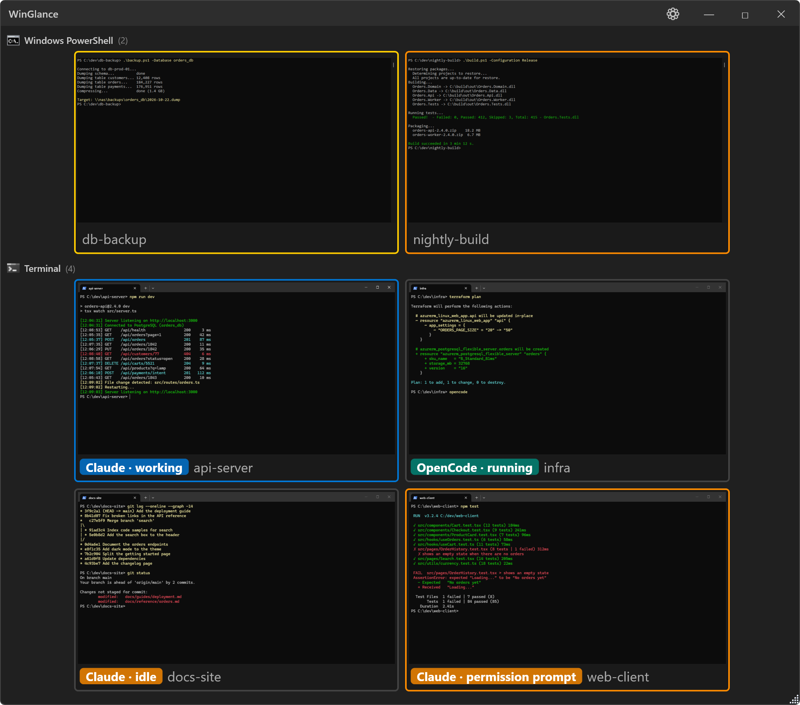
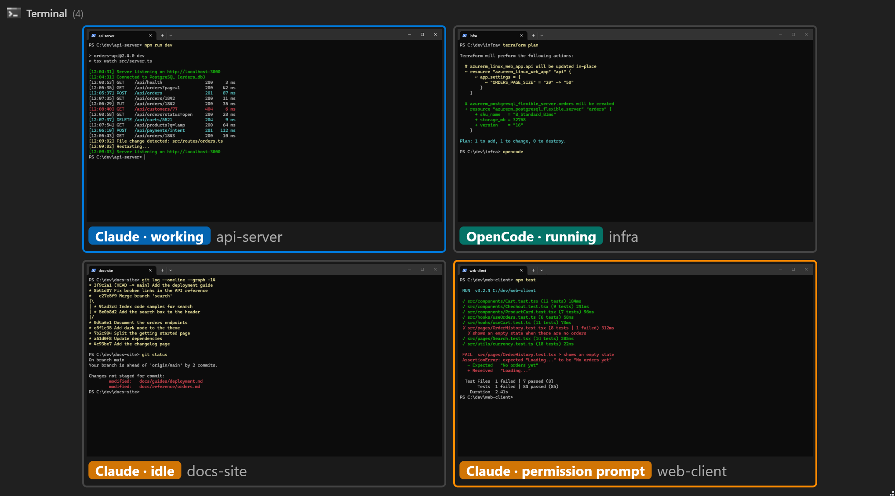
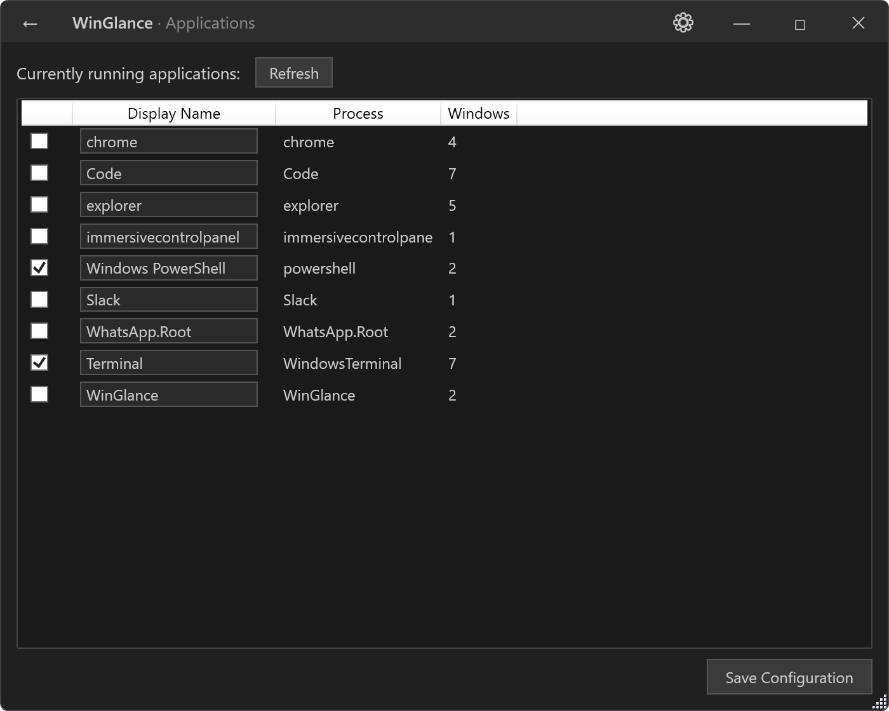

# WinGlance

A floating panel that keeps **live thumbnails** of the windows you care about always in view, with **one-click switching** and a glance at which coding agent is working, done, or waiting for you.



When working with multiple windows of the same application (e.g., several VS Code instances, each running a coding agent), the only way to see previews is by hovering over the taskbar icon — a transient popup that disappears immediately. WinGlance keeps those previews visible at all times, and tells you which window needs you.

## Features

- **Live DWM thumbnails** — real-time window previews rendered by the Windows Desktop Window Manager (zero CPU cost)
- **One-click switching** — click any thumbnail to bring that window to the foreground; a blinking red frame and a click from the side of its screen show you where it is
- **Dynamic tracking** — automatically detects new/closed windows (~1s polling)
- **Multi-app grouping** — thumbnails grouped by application with icons and titles
- **Window attention detection** — highlights windows that are flashing, not responding, or blocked by a modal dialog
- **Coding agent badges** — shows whether Claude Code or OpenCode runs in each window, and whether it is working, idle, or waiting for you
- **Agent notifications** — a Windows notification when an agent finishes or needs you while you are elsewhere, and a hotkey (default: Ctrl+Alt+N) that jumps to the next agent waiting for you
- **LLM-assisted analysis** — optional integration with OpenAI, Gemini, or Ollama to intelligently detect windows awaiting user action
- **Global hotkey** — configurable shortcut (default: Ctrl+Alt+G) to show/hide the panel
- **Dark/light theme** — auto-detects Windows system theme
- **Per-monitor DPI** — works correctly on multi-monitor setups with different scaling
- **System tray** — minimize to tray, single instance enforcement
- **Portable** — single `.exe`, no installer, config stored in `config.json`

## Coding Agent Badges



A badge under each thumbnail shows the agent running in the window: blue while Claude works, orange when it is idle or waits for your answer, teal for OpenCode. The border turns orange when an agent waits for you, or finished while you were in another window. Sessions come from `claude agents --json` (Claude Code v2.1.139 or later); they are matched to VS Code windows and terminals alike.

## Requirements

- Windows 10 or 11
- DWM enabled (default on all modern Windows installations)

## Getting Started

1. Launch `WinGlance.exe` (see [Build from Source](#build-from-source)).
2. Right-click the panel and open **Applications**; check the apps you want to monitor and click **Save Configuration**.
3. Click **←** in the title bar (or press **Esc**) to come back to the live thumbnails.
4. Click any thumbnail to switch to that window.



The **⚙** button opens quick options (transparency, switching cues, notifications); **Settings** holds everything else.

See the [User Manual](doc/USER_MANUAL.md) for every feature.

### LLM Analysis (optional)

WinGlance can use an LLM with vision capabilities to detect when a window is waiting for user action:

1. Go to **Settings** > **LLM Analysis**
2. Enable and select a provider (OpenAI, Gemini, or Ollama)
3. Enter your API key and model name, then click **Save Configuration** (no restart needed)
4. Customize the system prompt in the **Prompt Editor** view, which also shows a live log of each analysis

The API key is stored encrypted for your Windows account (DPAPI).

## Build from Source

```bash
# Clone the repository
git clone https://github.com/sebhuet/WinGlance.git
cd WinGlance

# Build
dotnet build src/WinGlance.slnx

# Run tests
dotnet test src/WinGlance.slnx

# Publish as a single-file executable
dotnet publish src/WinGlance/WinGlance.csproj -c Release -r win-x64 --self-contained -p:PublishSingleFile=true -o publish
```

Output: `publish/WinGlance.exe`. Without `-o`, build output goes to `%TEMP%\WinGlance\` (see `src/Directory.Build.props`), to keep it out of synced folders.

## Configuration

Settings are stored in `config.json` next to the executable (falls back to `%LOCALAPPDATA%\WinGlance\config.json` if the directory is read-only). Warnings and errors are logged to `%LOCALAPPDATA%\WinGlance\winglance.log`.

See [doc/SPECIFICATION.md](doc/SPECIFICATION.md) for the full config format.

## Project Structure

```text
WinGlance/
├── src/
│   ├── WinGlance/          # Main WPF application
│   └── WinGlance.Tests/    # xUnit test project
├── doc/
│   ├── SPECIFICATION.md    # Full technical specification
│   ├── USER_MANUAL.md      # User manual
│   └── images/             # Screenshots used by the manual and this README
├── TODO.md                 # Development roadmap
├── LICENSE                 # GPL-3.0
├── CONTRIBUTING.md         # Contribution guidelines
└── CODE_OF_CONDUCT.md      # Code of conduct
```

## Contributing

Contributions are welcome! Please read [CONTRIBUTING.md](CONTRIBUTING.md) before submitting a pull request.

## License

This project is licensed under the **GNU General Public License v3.0** — see [LICENSE](LICENSE) for details.
