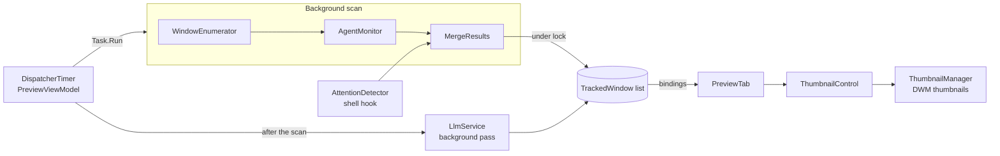

# WinGlance — Architecture

How the code works, for contributors. The [specification](SPECIFICATION.md) says what WinGlance must do, the [user manual](USER_MANUAL.md) what it does from the user's side; this guide explains how the pieces fit, which thread runs what, and how the code is tested.

## Overview

WinGlance is a single WPF process (.NET 10, `net10.0-windows`) built around one floating window, `MainWindow`, and four views switched inside it. It follows MVVM: views bind to ViewModels, ViewModels drive Services, Services call Win32 through `NativeApi/NativeMethods.cs`.



## Source map

All the code is in `src/WinGlance/`; tests mirror it in `src/WinGlance.Tests/`.

| Path                                          | Role                                                                                                             |
| --------------------------------------------- | ---------------------------------------------------------------------------------------------------------------- |
| `App.xaml.cs`                                 | Startup: log, single instance, DWM check, theme, configuration, `MainWindow`; global exception handlers          |
| `MainWindow.xaml(.cs)`                        | The panel: title bar, Options popup, context menu, tray icon, hotkeys, full screen, notifications, view switch   |
| `Models/AppConfig.cs`                         | `config.json` model: settings, `LlmConfig` (with the default prompt), `AgentDetectionConfig`                     |
| `Models/MonitoredApp.cs`                      | A monitored application: process name and display name                                                           |
| `Models/TrackedWindow.cs`                     | One window shown in the panel: handle, title, state flags, agent badge, LLM verdict; observable                  |
| `Models/AgentSession.cs`                      | One coding agent session as discovered (process, folder, status)                                                 |
| `Models/AgentBadge.cs`                        | The badge of a window: most urgent session, label, tooltip                                                       |
| `Models/AgentTransition.cs`                   | Agent changes worth notifying (finished, needs input) and their notification text                                |
| `Services/WindowEnumerator.cs`                | `EnumWindows` with the taskbar's rules; UWP name resolution; icons; hung and modal flags; Applications discovery |
| `Services/ThumbnailManager.cs`                | DWM thumbnail registrations from source windows to the panel                                                     |
| `Services/ThumbnailLayoutCalculator.cs`       | Largest thumbnail size for the "fit" layout; scale of the status row                                             |
| `Services/AttentionDetector.cs`               | Shell hook (`HSHELL_FLASH`) for flashing windows                                                                 |
| `Services/AgentMonitor.cs`                    | Periodic agent discovery in the background, matched to windows on each scan                                      |
| `Services/ClaudeAgentSource.cs`               | Runs `claude agents --json` and parses it                                                                        |
| `Services/OpenCodeAgentSource.cs`             | Finds `opencode.exe` processes and their working folder                                                          |
| `Services/ClaudeToolShells.cs`                | Counts the commands an idle Claude session still runs in the background                                          |
| `Services/ProcessTree.cs`                     | Snapshot of all processes and their parents                                                                      |
| `Services/AgentWindowMatcher.cs`              | Ties a session to the window hosting it (process lineage, then folder name in the title)                         |
| `Services/LlmService.cs`                      | Stale detection, then one LLM analysis per unchanged window; retry delay; cancellation                           |
| `Services/LlmAnalyzer.cs`                     | HTTP calls to OpenAI, Gemini and Ollama; verdict parsing                                                         |
| `Services/ScreenshotComparer.cs`              | `PrintWindow` capture and perceptual (average) hash                                                              |
| `Services/HotkeyService.cs`                   | Parses `Ctrl+Alt+G`-style hotkeys and registers them                                                             |
| `Services/WindowHighlighter.cs`               | Blinking red frame around the window switched to                                                                 |
| `Services/StereoClick.cs`, `ScreenSide.cs`    | Short click panned to the side of the window's screen                                                            |
| `Services/ConfigService.cs`                   | Config path, atomic save, normalization of values read                                                           |
| `Services/SecretProtector.cs`                 | DPAPI encryption of the LLM API key                                                                              |
| `Services/AutoStartService.cs`                | "Start with Windows" through the `HKCU\…\Run` key                                                                |
| `Services/ThemeService.cs`                    | Follows the Windows light/dark setting                                                                           |
| `Services/Log.cs`                             | `%LOCALAPPDATA%\WinGlance\winglance.log`                                                                         |
| `ViewModels/MainViewModel.cs`                 | Builds and links the child ViewModels; LLM service lifecycle                                                     |
| `ViewModels/PreviewViewModel.cs`              | Window list, polling, layout sizes, activation, agent state and transitions                                      |
| `ViewModels/ApplicationsViewModel.cs`         | Running applications and the monitored set                                                                       |
| `ViewModels/SettingsViewModel.cs`             | Settings, applied live or on save                                                                                |
| `ViewModels/PromptEditorViewModel.cs`         | LLM prompt and debug log                                                                                         |
| `ViewModels/ViewModelBase.cs`, `RelayCommand` | `INotifyPropertyChanged` base and `ICommand` helper                                                              |
| `Views/*Tab.xaml`                             | The four views                                                                                                   |
| `Controls/ThumbnailControl.cs`                | Places one DWM thumbnail over its layout slot, keeping the window's proportions                                  |
| `Converters/`                                 | Border color from the window state, visibility, layout, LLM verdict                                              |
| `Themes/`                                     | `DarkTheme.xaml` and `LightTheme.xaml`: the brushes every view uses through `DynamicResource`                    |
| `NativeApi/NativeMethods.cs`                  | Every P/Invoke declaration                                                                                       |

## Startup

`App.OnStartup` initializes the log, then takes the `WinGlance_SingleInstance_Mutex`. A second instance broadcasts the registered `WinGlance_ShowPanel` message, which makes the first one show its panel, and exits. WinGlance then checks that DWM composition is on, applies the theme, loads `config.json`, repairs a stale "Start with Windows" entry (the portable exe was moved) and opens `MainWindow`.

`MainWindow` builds a `MainViewModel` from the configuration, creates the tray icon and, once loaded (it needs a window handle):

- registers the two global hotkeys and the shell hook;
- connects the actions that follow a thumbnail click (red frame, side click, leaving full screen);
- turns agent transitions into tray notifications;
- starts the polling.

## The polling cycle

`PreviewViewModel` owns a `DispatcherTimer` (default 1 s). Each tick:

1. **Scan, on a pool thread** (`Task.Run(Poll)`). `WindowEnumerator.GetWindows` lists the windows of the monitored applications. Icons are only extracted for windows that have none yet, and `WM_GETICON` has a timeout so that a hung window cannot stall the scan. `AgentMonitor.GetBadges` attaches the agent badges.
2. **Merge, under `_lock`**. `MergeResults` updates the existing `TrackedWindow` instances in place (thumbnails stay registered on them), adds new windows and removes closed ones, and computes agent transitions. `BindingOperations.EnableCollectionSynchronization` lets WPF read the collection while the pool thread changes it. Transitions are raised after the lock is released.
3. **LLM pass, on a pool thread**, if LLM analysis is on. It runs over a snapshot of the windows and is skipped while the previous pass is still running.

A scan never overlaps the previous one (`_isScanning`), so a slow window delays the next scan instead of piling scans up. Exceptions are logged and never rethrown on the dispatcher, which would open an error dialog every second.

## Thumbnails and layout

The live previews are DWM thumbnails: Windows composes the source window into a rectangle of the panel, at no CPU cost to WinGlance. `ThumbnailControl` computes that rectangle from its layout slot (keeping the window's proportions, clipped to the scroll viewer) and hands it to `ThumbnailManager`.

Two constraints follow, and every view change must respect them:

- **DWM draws above WPF content.** Anything placed over a thumbnail rectangle is hidden, so badges and titles sit in a row under it, and popups (Options panel, context menu) are separate windows.
- **Item heights are fixed.** A thumbnail whose position shifts without a size change is not redrawn at its new place, so a badge appearing must not move the thumbnails that follow.

In the "fit" layout, `ThumbnailLayoutCalculator` tries every number of columns and keeps the largest thumbnails that fit the panel, from the typical proportions of the windows. The status row is scaled with the thumbnails (`StatusRowScale`), so that its text stays readable on large thumbnails.

## Switching to a window

A thumbnail click runs `PreviewViewModel.Activate`. The window is restored if minimized, then a simulated Alt press lifts Windows' foreground lock before `SetForegroundWindow`: without it, Windows would only flash the taskbar button. `WindowActivated` then lets `MainWindow` leave full screen, outline the window with `WindowHighlighter` and play `StereoClick` on the side of the window's screen.

## Attention states

Each scan sets the state flags of every window:

| Flag                  | Source                                                                                       |
| --------------------- | -------------------------------------------------------------------------------------------- |
| `IsHung`              | `IsHungAppWindow`                                                                            |
| `IsModalBlocked`      | `!IsWindowEnabled`: a modal dialog disables its owner                                        |
| `IsFlashing`          | `HSHELL_FLASH` received by `AttentionDetector`; cleared when the window gets the focus       |
| `NeedsAgentAttention` | `ApplyAgentState`: agent waiting while the window is not in front, or a turn finished unseen |
| `LlmVerdict`          | `LlmService`                                                                                 |

`WindowStateToBorderBrushConverter` turns them into one border color, in priority order: not responding (red), agent waiting for an answer (red), flashing, agent finished or LLM "awaiting action" (orange), modal dialog (yellow), active (blue), inactive (gray).

## Coding agents

Claude Code sessions come from `claude agents --json`, the interface the Claude Code documentation offers to external tools. The files under `~/.claude` are not a stable interface and are never read. OpenCode reports no state, so it is found from its process.

- **Discovery** (`AgentMonitor`, every 5 s by default, in the background): a process tree snapshot, then the CLI. The CLI is only spawned while a `claude.exe` process exists, or always when Claude Code was installed by npm, whose sessions run as `node.exe`. For each idle Claude session, `ClaudeToolShells` counts the shells its tools still run, so that background commands count as work in progress.
- **Matching** (`AgentWindowMatcher`): the session's process lineage is walked up to the first process owning a tracked window. When that process owns several windows (one VS Code or Windows Terminal process serves all its windows), the session's folder is looked for in their titles. A tie leaves the session unassigned rather than guessing.
- **Badge** (`AgentBadge`): the most urgent session gives the label and color; `+N` counts the others.
- **Transitions** (`ApplyAgentState`): busy → idle is "finished", → waiting is "needs input". An agent first seen already waiting is not a transition, to avoid a burst of notifications at startup. `MainWindow` shows them as tray notifications when `agentDetection.notify` is on.
- **Next agent hotkey** (`FindNextAgentWindow`): waiting agents first, then finished turns not seen yet, then idle agents, cycling from the window in front.

## LLM analysis

`LlmService.EvaluateAsync` hashes a capture of the window. When the hash stays the same for the stale threshold (30 s by default), it sends one screenshot and the window title to the model through `LlmAnalyzer`, and stores the verdict on the window. A new analysis only happens once the content changes and becomes stale again. A failed call (wrong key, endpoint down, timeout) is retried after `RetryDelay` (one minute) rather than on every tick. Hung windows are never captured, since `PrintWindow` would wait for them.

`MainViewModel.ApplyLlmSettings` rebuilds the service whenever the settings are saved: disposing the old one cancels its calls in flight and clears the verdicts it left.

## Configuration and persistence

- **Location**: `config.json` next to the executable, or `%LOCALAPPDATA%\WinGlance\config.json` when that folder is not writable (`ConfigService.ResolveConfigPath`).
- **Saving**: atomic, through a temporary file renamed over the old one, so that a crash never leaves a half-written file.
- **Loading**: a missing or corrupt file gives the defaults; `Normalize` replaces missing sections and out-of-range values.
- **API key**: stored as `apiKeyProtected`, encrypted with DPAPI for the current Windows user (`SecretProtector`). A plaintext `apiKey` typed by hand is read, then encrypted at the next save.
- **Panel position and size**: saved when the panel is hidden, on exit and when Windows ends the session.
- **Start with Windows**: the registry is the source of truth; the setting shown is read from it at startup.
- **Log**: `Log` writes to `Trace` only until `Initialize` is called. Tests therefore never write to the user's log.

## Theming

`ThemeService` reads `AppsUseLightTheme` and merges `DarkTheme.xaml` or `LightTheme.xaml` into the application resources, again whenever Windows reports a preference change. Views only use `DynamicResource` brushes from these dictionaries; controls whose default Windows template ignores them (the `ComboBox`, the `GridView` column headers) get a template of their own in the view's resources.

## Testing

Run the tests with `dotnet test src/WinGlance.slnx`. They are xUnit tests that mirror the source folders, named `MethodName_Condition_ExpectedResult`.

### Seams

Code that touches the system takes its dependencies through an `internal` constructor or parameter, visible to the tests through `InternalsVisibleTo`:

| Class                                    | Replaceable dependency                                     |
| ---------------------------------------- | ---------------------------------------------------------- |
| `ConfigService(string)`                  | Configuration folder                                       |
| `LlmAnalyzer(…, HttpClient)`             | HTTP transport (a stub `HttpMessageHandler` answers)       |
| `LlmService(…)`                          | Window hash, capture, analyzer and clock                   |
| `AgentMonitor(int, ClaudeAgentSource)`   | Claude CLI path                                            |
| `ApplicationsViewModel(…, discover)`     | Running applications scan                                  |
| `SettingsViewModel`, `MainViewModel`     | `applyAutoStart`: the "Start with Windows" registry writer |
| `PreviewViewModel.MergeResults(scanned)` | A scan result, without enumerating windows                 |
| `AttentionDetector.HandleShellMessage`   | A shell hook notification, without a hook window           |

### Rules

- **Never touch the user's state**: no registry write (pass `applyAutoStart`), no file outside a temporary folder, no log file, no real window.
- **WPF elements need an STA thread**: wrap the test in `ViewTestHelpers.RunOnSta`. View tests render offscreen with `ViewTestHelpers.Layout`, and replace theme brushes through `view.Resources` to check that a control follows the theme.
- **Not unit tested**: `App`, `MainWindow`, DWM thumbnails, the shell hook window, screen capture and window activation need a desktop session. Check them by running the app, following the verification plan in the specification.

### Coverage

```bash
dotnet test src/WinGlance.slnx --settings src/coverage.runsettings --collect:"XPlat Code Coverage" --results-directory TestResults
```

`coverage.runsettings` leaves out the code generated from XAML. Each run writes a Cobertura report, `TestResults/<run id>/coverage.cobertura.xml`. Read it with an IDE, or turn it into HTML with [ReportGenerator](https://github.com/danielpalme/ReportGenerator):

```bash
dotnet tool install --global dotnet-reportgenerator-globaltool
reportgenerator -reports:"TestResults/*/coverage.cobertura.xml" -targetdir:TestResults/report
```

In October 2026, the logic (Models, Services, ViewModels, Converters) was covered at about 85 % of its lines, and the whole project at 70 %. The files below 60 % are the ones that need a desktop session or the registry: `ThemeService`, `AutoStartService`, `WindowHighlighter`, `ThumbnailControl`, `StereoClick`, `ThumbnailManager`, and `App` and `MainWindow` at 0 %.

## Documentation and screenshots

The screenshots in `doc/images/` are taken at 200 % scaling on staged windows: consoles printing fictitious output, and a stand-in for `claude agents --json` listing fictitious sessions. Never capture real windows: their content would be published with the repository. Images are referenced with `` at half their pixel width, so that they show at their real size on GitHub.
